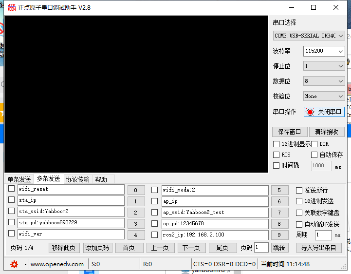

# 电脑串口配置该模块的指令说明（ROS版本）

[toc]

## 模块要和usbttl模块连接
|usbttl|wifi摄像头|
|:---:|:----:|
|RX|TX|
|TX|RX|
|GND|GND|
|VCC|VCC|


## 串口配置
**波特率115200、无奇偶校验、无硬件流控、1位停止位**
如果使用的是串口助手配置，在发送指令要 **去掉** 自动发送新行（附加位）
如图所示：


### 1.配置STA模式下的wifi指令（连接局域网的模式）
|       指令       |      说明        |         例子        |         备注        |
| :----------------:| :------------: | :------------------:|:------------------:|
| sta_ssid:        |  要连接的wifi名称|   sta_ssid:nanocam |  nanocam:就是要连接的wifi|
| sta_pd:         |  要连接的wifi密码 |   sta_pd:12345678  | 12345678:就是要连接的wifi密码|

**注意事项**
1. 无论是sta_ssid还是sta_pd 后面一定要接一个英文字符的表点符号 如**逗号（,）、冒号(:)、句号(.)等等**
2. 当要连接的wifi没有密码时，要这样发送一次**sta_pd:** 即可。
3. 上述的指令成功会返回 **OK** 的信息 ，没信息返回要检查串口接线
4. 当这样发送 **sta_ssid:** 指令时，会返回 **fail,ssid is null!** 的字符，说明连接wifi名称不能为空
5. 指令的发送可以全部大写或者全部小写 
6. wifi的名称和密码都不能超过30个字符的长度，否则配置失败 
7. wifi的名称、密码不能有中文字符
8. **wifi密码每次发生新的改变，都会自动复位，如果只更改wifi名称需要手动断电复位**


### 2.配置AP模式下的wifi指令（模块自发热点模式）
|       指令       |      说明        |         例子        |         备注        |
|:----------------:| :-------------: |:------------------:|:------------------:|
| ap_ssid:         |  要设置的wifi名称|   ap_ssid:my_wifi |  my_wifi:就是要设置的wifi|
| ap_pd:           |  要设置的wifi密码 |   sta_pd:12345678  | 12345678:就是要设置的wifi密码|

**注意事项**
1. 无论是ap_ssid还是ap_pd后面一定要接一个英文字符的表点符号 如**逗号（,）、冒号(:)、句号(.)等等**
2. 当要设置的wifi没有密码时，要这样发送一次 **ap_pd:** 即可。
3. 上述的指令成功会返回 **OK**的信息 ，没信息返回要检查串口接线
4. 当这样发送 **ap_ssid:** 指令时，会返回 **fail,AP_Name is null!** 的字符，说明设置wifi名称不能为空
5. 指令的发送可以全部大写或者全部小写 
6. wifi的名称和密码都不能超过30个字符的长度，否则配置失败 
7. wifi的名称、密码不能有中文字符
8. **wifi密码每次发生新的改变，都会自动复位，如果只更改wifi名称需要手动断电复位**

### 3.配置wifi模式
|       指令       |      说明        |         例子        |               备注                    |
| :----------------:| :------------: | :------------------:|:------------------:|
| wifi_mode:     | 配置wifi模式       |  wifi_mode:2         |  0：AP模式  1：STA模式  2：AP+STA模式 |

**注意事项**
1. wifi_mode 后面一定要接一个英文字符的表点符号 如**逗号（,）、冒号(:)、句号(.)等等**
2. wifi_mode 一共只能设置3个模式，如果传入的负数，默认是AP模式 ，大于2的数，默认是AP+STA模式

### 4.其它的指令
|       指令       |      说明         |         例子        |         返回值        |
|:----------------:| :-------------:  |:------------------:|:--------------------:|
| sta_ip           |  查询sta模式的ip地址|   sta_ip         | 返回连接到局域网的ip地址<br />(如sta_ip:192.168.2.199) |
| ap_ip           |   查询ap模式的ip地址 |   ap_ip           | 返回自身开wifi模式的ip地址<br />(如ap_ip:192.168.4.1) |
| wifi_reset     | 把wifi配置恢复成出厂设置|  wifi_reset     |   Reset_OK            |
| wifi_ver       |    查询wifi固件的版本   |  wifi_ver       | NANOCAM VerSion:1.8.3  |

**注意事项**
1. 指令的发送可以全部大写或者全部小写 
2. 上述的指令成功会有返回值的对应的信息，没信息返回要检查串口接线
3. wifi_reset是把wifi模式配置成AP+STA模式，ap的wifi名称是**NanoCam_ESP32_WIFI**,无密码,会自动复位，无需手动复位


### 5.配置ROS ip的指令
|       指令       |      说明        |         例子        |         备注        |
| :----------------:| :------------: | :------------------:|:------------------:|
| ros2_ip:       |  要连接的主机代理|   ros2_ip:192.168.2.105 |  192.168.2.105:就是代理主机的ip地址|


**注意事项**
0. 代理主机就是一个有ROS2（humble）的环境unbutu的系统
1. 指令的发送可以全部大写或者全部小写 
2. ros2_ip 后面一定要接一个英文字符的表点符号 如**逗号（,）、冒号(:)、句号(.)等等**
3. 连接的主机ip一定要和esp32连接的wifi是同一个网段
4. ROS2的启动只能通过STA模式/或者双模式共存的模式下，不能只用AP热点模式，否则将无法实现ROS系统
5. 代理的端口是9999 , 在主机终端启动的命令如下:
```
docker run -it --rm -v /dev:/dev -v /dev/shm:/dev/shm --privileged --net=host microros/micro-ros-agent:humble udp4 --port 9999 -v4
```
5. domainid:20  ROS2的domainid默认是0，要使用ros2系统通信 主机要把domainid改成20