# ROS2上观看摄像头画面

[toc]

## 0.在一个linux系统下安装docket
```shell
# **如果使用的是资料提供的系统此步跳过**
sudo apt update
sudo apt install docker.io docker-compose
docker -v
```
如图所示 docker就下载并安装完成
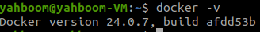

## 1.启动ROS-Wifi图传模块 ROS2代理
1. 先把ROS-Wifi图传模块的STA模式启动(默认启动) 让esp32连接到所处环境的一个能上网的wifi
**注意：使用AP模式是不能进入代理的，因为进去代理需要网络，AP模式是没有网络**
2. 代理主机也要和ROS-Wifi图传模块连接到同一个局域网
**代理主机：是一个装有ROS2(humble版本)的Linux系统**
3. 查询代理主机的ip地址
输入：ifconfig的命令
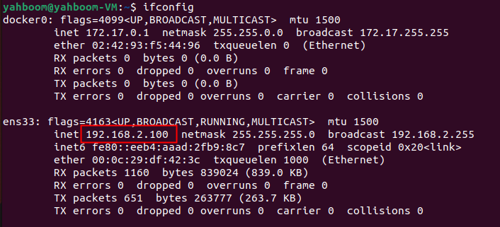

4. 然后使用串口工具，配置ROS-Wifi图传模块的ros2代理主机地址
- 比如上图，我的ip地址是**192.168.2.100**，那么串口的配置如图所示
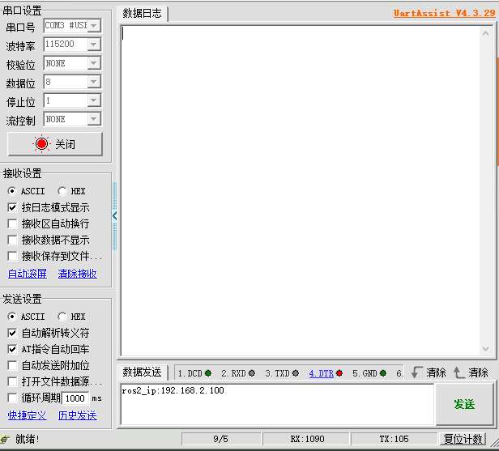
- 点击发送后，有两种信息打印，**无论那种都是配置完成的了**
  1. 如果ROS-Wifi图传模块原本的代理ip和现在的不一样，就会更新现在的代理ip并重启
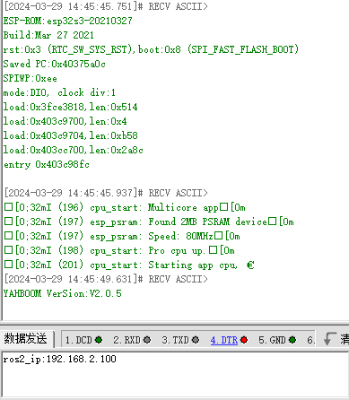
  2. 如果ROS-Wifi图传模块原本代理的ip就和现在一样，ROS-Wifi图传模块则会返回一个OK的信息
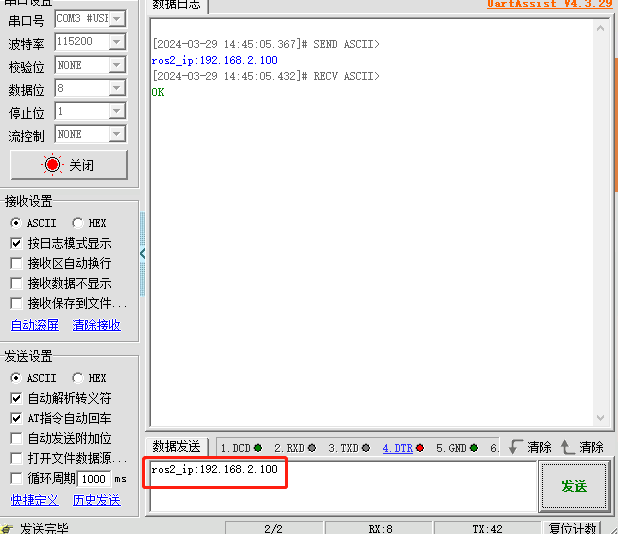

5. 在完成ROS-Wifi图传模块的代理配置完成后，在代理主机执行以下的命令
```shell
#如果使用的资料的虚拟机直接运行命令
sh start_Camera_computer.sh
```

```shell
#不是资料提供的虚拟机
docker run -it --rm -v /dev:/dev -v /dev/shm:/dev/shm --privileged --net=host microros/micro-ros-agent:humble udp4 --port 9999 -v4
```
- 这个9999的端口会被使用进入代理，在个人后续开发的 要避免使用此端口

成功进入的结果如图所示:
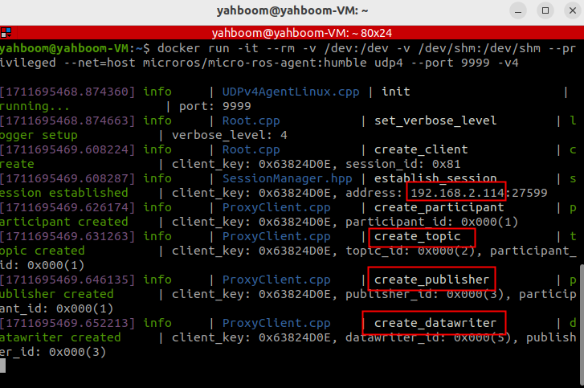
**一定要有这么多信息才算正确的开启了代理，缺少一个可能需要手动把ROS-Wifi图传模块断电复位**
**由上图代理结果的信息可以得到ROS-Wifi图传模块的ip:192.168.2.114**

6. 查询ROS-Wifi图传模块发布的ROS2结点、话题信息、话题发布频率、话题消息类型
### 发布节点
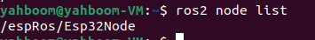

### 话题信息
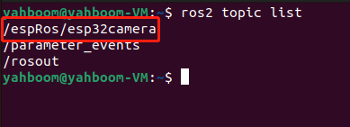
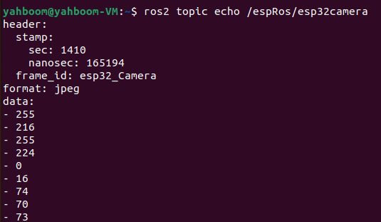

### 消息类型
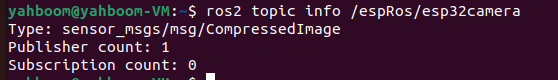

### 话题发布频率
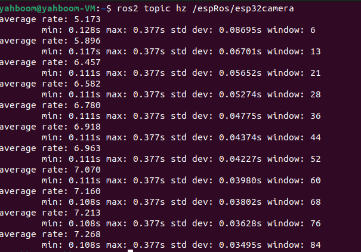


## 2.ROS2获取摄像头画面
**注意：如果使用的是资料提供的虚拟机只看第4步即可**
1. 先创建文件夹，执行以下命令
```
mkdir -p ~/nanocamcar_ws/src
```

2. 把资料的提供的**nanocam_esp32_camera**放到刚才创建好的路径里面，并解压
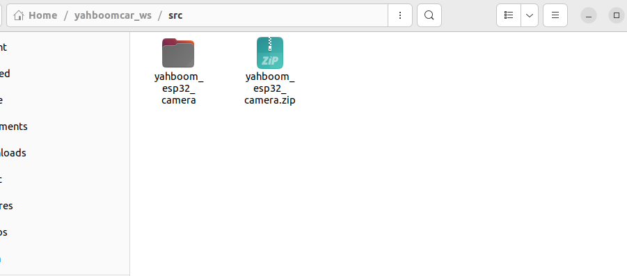

3. 然后功能包编译并添加环境
```
colcon build
echo "source ~/nanocamcar_ws/install/setup.bash " >> ~/.bashrc
source ~/.bashrc
```

4. 运行命令打开摄像头画面
```
ros2 run nanocam_esp32_camera sub_img
```
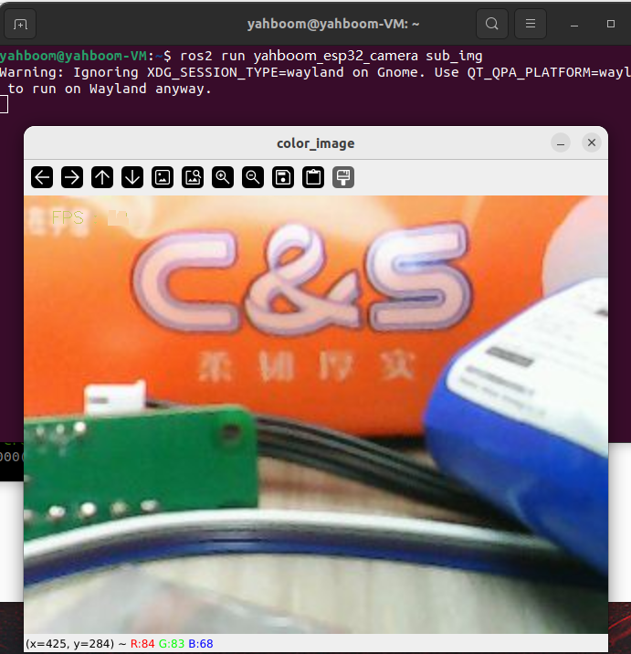


## 3.在RVIZ里面查看图片
1. 前提条件ROS2获取摄像头画面的条件下，打开安装好的rviz软件
```shell
rviz2 #rviz/rviz2 资料的虚拟机打开rviz的命令

```

2. 把fixed frame的话题 替换成 **/esp32_img**这个话题
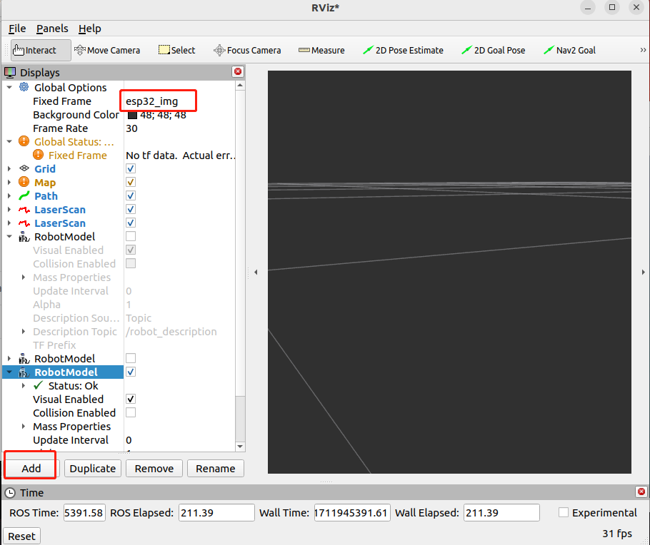

3. 然后加载这话题的图片
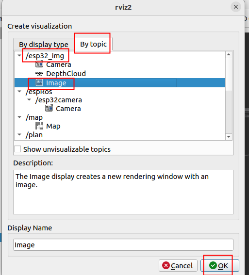

4. 最后rviz显示出摄像头的画面
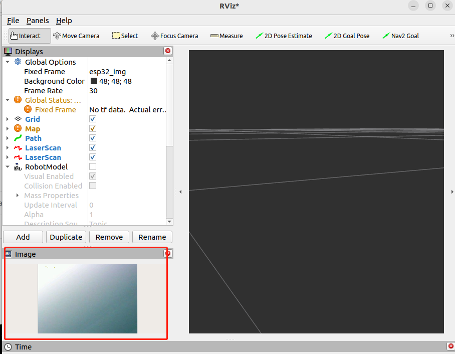

## 4.注意事项
1. 如果主机主动断开代理，需要把ROS-Wifi图传模块手动断电重启，才能重新恢复，连接代理
2. 这个9999的端口会是进入代理的，在个人后续开发的 要避免使用此端口
3. 使用代理只能通过STA(连接局域网)的模式进行配置。