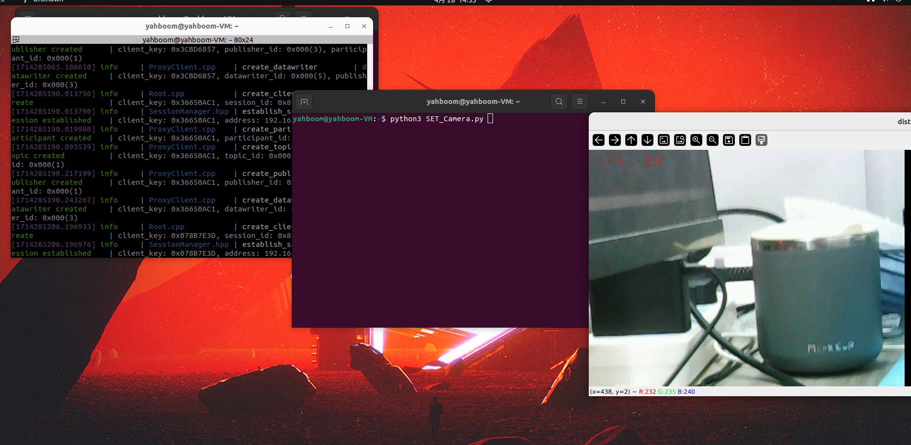
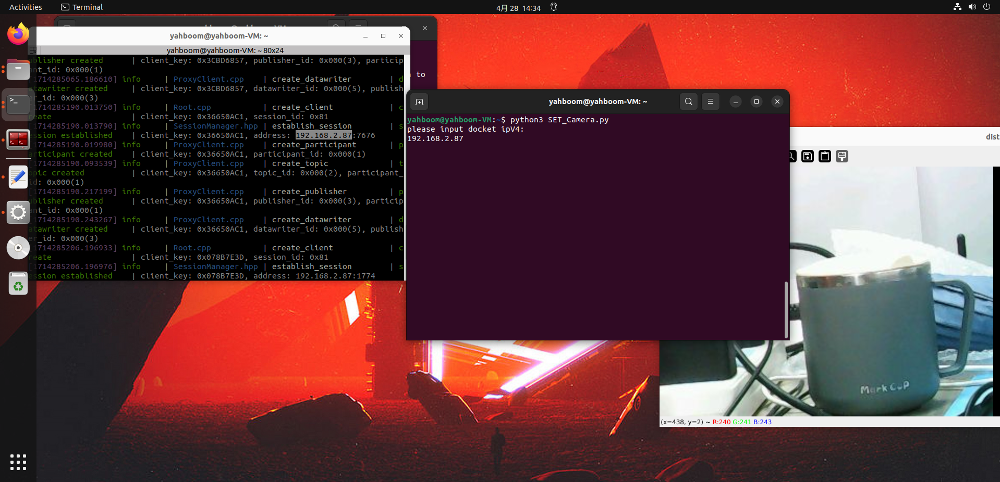
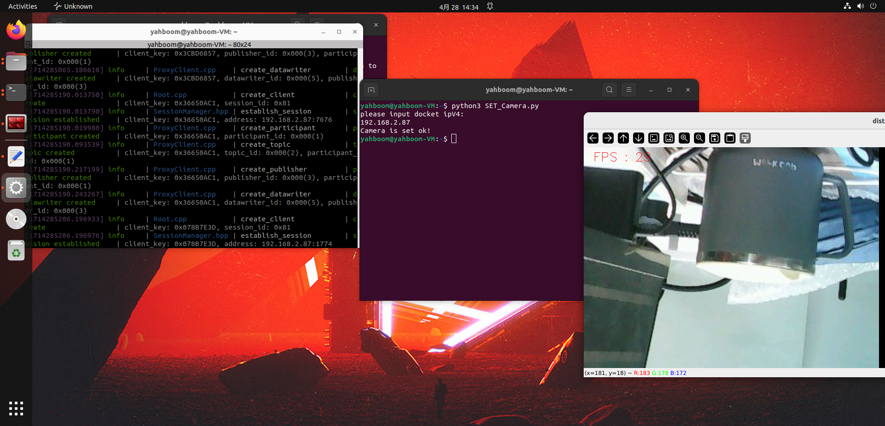
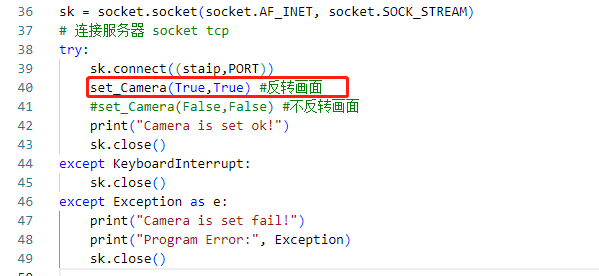

# 3.摄像头画面的改变

当安装esp32的时候是反的，即供电口朝下，这时的摄像头的画面是倒置过来的。
这是就需要设置一下摄像头画面，操作步骤如下:
1. 先把资料里面的**SET_Camera.py**放在Linux的系统下,任何位置都可以
2. 然后到有SET_Camera.py的目录下打开终端，运行命令

``` shell
python3 SET_Camera.py
```
3. 在终端，输入docket终端（开docket的命令，看**2.ROS2查看摄像头教程**）获取到的ip地址，按回车



4. 当出现 **Camera is set ok!** 摄像头的画面就反转过来了


**当你不需要反转摄像头了，有两种办法恢复**
1. 断电重启摄像头
2. 修改**SET_Camera.py**的第40，41行
**注释40行，41行取消注释**

然后按上述的办法重新运行一遍即可恢复摄像头画面
