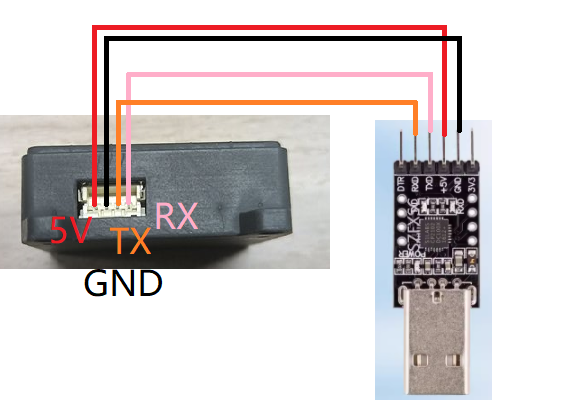

# ROS图传模块使用的前提条件


## 此文档说明 图传模块 在 ROS2系统上的使用设置

- 刚到手的ROS版的图传模块 是一个完整的模块，里面的ros2的ip代理存储的可能不是一个出于现有的网络的ip地址。

- 下面进行操作，使其得到相关的配置，可以成功的在ROS2系统上使用

### 操作步骤
1. 首先把图传模块和CH340进行连接

|CH340|wifi摄像头|
|:---:|:----:|
|RX|TX|
|TX|RX|
|GND|GND|
|VCC|VCC|
|如图所示:||

2. 打开串口助手，把串口配置成以下的选项
**波特率115200、无奇偶校验、无硬件流控、1位停止位**
并且在发送指令要**去掉** 自动发送新行（附加位）

3. 连接手机可以搜到的2.4GHz网络的wifi
串口助手输入以下的指令：
   1. 先把模式配置成连接wifi的模式
   ```
   wifi_mode:2
   ```
   点击发送，等待串口助手返回重启信息或是ok的回应

   2. 把要连接的wifi名称发送过去
   ```
   sta_ssid:连接的wifi名称
   ```
   点击发送，等待串口助手返回重启信息或是ok的回应

   3. 把要连接的wifi密码发送过去
   ```
   sta_pd:连接的wifi密码
   ```

   4. 查找要连接ROS2的系统 IP地址(在终端输入ifconfig自行查找)，不懂可以到**ROS2上观看摄像头画面**教程看操作，此文档不再阐述。
   ```
   ros2_ip:找到的ROS2系统的ip
   ```

4. 到此为止，ros的图传模块配置就完成了设置，可以根据配置的ROS2系统，启动它的代理了。必须是humble版本的ROS2
需要注意：
- **当连接ROS2的主机ip发生改变，或者是连接的wifi改变了**，都需要重新进行配置。
- ROS2的系统和ROS图传模块要保持连接同一个局域网。
- 如果不想使用串口助手去配置，也可以使用单片机去配置它，需要有一定的基础编程能力，根据**串口配置WiFi说明**此文档的协议，实现自己的DIY即可，此资料不再过多讲解。


