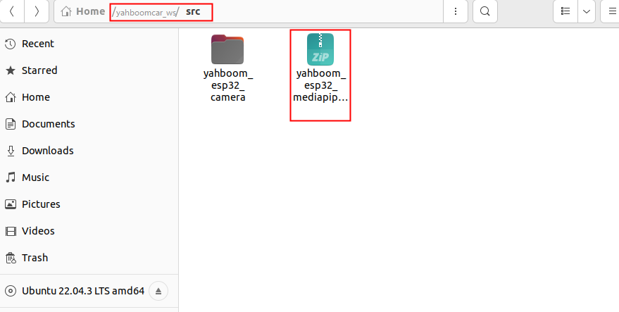
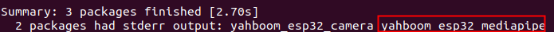

# **如果使用的是资料提供的虚拟机，此教程无需操作**

# 0.Mediapipe的安装

## 1. mediapipe安装操作步骤
1. 在一个带有humble版本的ROS2的Linux系统上运行一下命令
```shell
sudo apt update
pip install -i https://pypi.tuna.tsinghua.edu.cn/simple numpy
pip3 install -i https://pypi.tuna.tsinghua.edu.cn/simple opencv-python
pip3 install -i https://pypi.tuna.tsinghua.edu.cn/simple opencv-contrib-python
pip install -i https://pypi.tuna.tsinghua.edu.cn/simple mediapipe
pip3 install -i https://pypi.tuna.tsinghua.edu.cn/simple dlib
```
**如果提示python有模块找不到的错误，可以使用此命令安装对应的第三方模块即可**
```
pip3 install -i https://pypi.tuna.tsinghua.edu.cn/simple 第三方模块
```

**如果是ROS2的包找不到，可以使用此命令安装对应的包**
```
sudo apt install ros-humble-包名   
```

温馨提示:如果不懂操作，错误复制百度一下就有解决办法.


2. 运行了的以上命令就安装完成了midiapipe。

## 2.mediapipe功能包的搭建
1. 注意:如果在**2.ROS2查看摄像头**的教程已经创建了"nanocamcar_ws/src"这个路径，那么把资料的**nanocam_esp32_mediapipe.zip**传到此路径并运行以下命令

```shell
uzip nanocam_esp32_mediapipe.zip
cd ../nanocamcar_ws #进入nanocamcar_ws文件夹了,根据自己创建的路径
colcon build
```
编译成功，就成功的把mediapipe功能包加载到ROS2的环境当中，如图所示



2. **如果是直接看这个教程，前面的教程没看的情况，请先运行以下的命令**
```shell
#先创建一个路径
mkdir -p ~/nanocamcar_ws/src
echo "source ~/nanocamcar_ws/install/setup.bash " >> ~/.bashrc
source ~/.bashrc
```
**然后再回到第一步操作即可**


**图中的nanocam_esp32_camera**是**2.ROS2查看摄像头**教程里面搭建的，此功能包和mediapipe功能了包是互不影响的