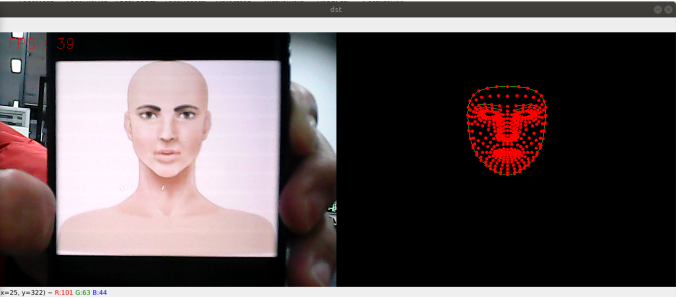

## 面部检测

### 1、简介

MediaPipe是⼀款由Google开发并开源的数据流处理机器学习应⽤开发框架。它是⼀个基于图的数据处理管线，⽤于构建使⽤了多种形式的数据源，如视频、⾳频、传感器数据以及任何时间序列数据。MediaPipe是跨平台的，可以运⾏在嵌⼊式平台(树莓派等)，移动设备(iOS和Android)，⼯作站和服务器上，并⽀持移动端GPU加速。 MediaPipe为实时和流媒体提供跨平台、可定制的ML解决⽅案。MediaPipe 的核⼼框架由 C++ 实现，并提供 Java 以及 Objective C 等语⾔的⽀持。MediaPipe 的主要概念包括数据包（Packet）、数据流（Stream）、计算单元（Calculator）、图（Graph）以及⼦图（Subgraph）。

MediaPipe的特点：

- 端到端加速：内置的快速ML推理和处理即使在普通硬件上也能加速。
- ⼀次构建，随时随地部署：统⼀解决⽅案适⽤于Android、iOS、桌⾯/云、web和物联⽹。
- 即⽤解决⽅案：展⽰框架全部功能的尖端ML解决⽅案。
- 免费开源：Apache2.0下的框架和解决⽅案，完全可扩展和定制。

### 2、Dlib

DLIB是⼀个现代C++⼯具包，包含机器学习算法和⼯具，⽤于在C++中创建复杂的软件来解决现实世界问题。它被⼯业界和学术界⼴泛应⽤于机器⼈、嵌⼊式设备、移动电话和⼤型⾼性能计算环境等领域。dlib库采⽤68点位置标志⼈脸重要部位，⽐如18-22点标志右眉⽑，51-68标志嘴巴。使⽤dlib库的get_frontal_face_detector模块探测出⼈脸，使⽤shape_predictor_68_face_landmarks.dat特征数据预测⼈脸特征数值。


### 3、面部检测

#### 3.1、启动

1. 先给ROS-wifi图传模块设置好代理的IP，具体的步骤，请看基本使用的**1.ROS-wifi图传模块在micros小车的使用**教程，本教程不再阐述

2. Linux 系统连接ROS-wifi图传模块，启动docket，输入以下指令进行ROS-wifi图传模块的连接
```shell
#使用提供的系统直接输入
sh start_Camera_computer.sh
```


```shell
#不是资料的系统:
docker run -it --rm -v /dev:/dev -v /dev/shm:/dev/shm --privileged --net=host microros/micro-ros-agent:humble udp4 --port 9999 -v4
```

出现以上信息，说明代理连接成功
3. 打开一个新的终端，执行以下命令
```
ros2 run nanocam_esp32_mediapipe 04_FaceMesh
```


4. 如果摄像头的画面是倒置的，请看**基础使用的3.摄像头画面改变**教程，本教程不再阐述


#### 3.2、代码解析

该功能源码的位置位于，

```
~/nanocamcar_ws/src/nanocam_esp32_mediapipe/nanocam_esp32_mediapipe/04_FaceMesh.py
```

```py
class FaceMesh(Node):
    def __init__(self, name,staticMode=False, maxFaces=2, minDetectionCon=0.5, minTrackingCon=0.5):
        super().__init__(name)
        self.mpDraw = mp.solutions.drawing_utils
        self.mpFaceMesh = mp.solutions.face_mesh
        self.faceMesh = self.mpFaceMesh.FaceMesh(
            static_image_mode=staticMode,
            max_num_faces=maxFaces,
            min_detection_confidence=minDetectionCon,
            min_tracking_confidence=minTrackingCon )
        self.pub_point = self.create_publisher(PointArray,'/mediapipe/points',1000)
        self.lmDrawSpec = mp.solutions.drawing_utils.DrawingSpec(color=(0, 0, 255), thickness=-1, circle_radius=3)
        self.drawSpec = self.mpDraw.DrawingSpec(color=(0, 255, 0), thickness=1, circle_radius=1)

    def pubFaceMeshPoint(self, frame, draw=True):
        pointArray = PointArray()
        img = np.zeros(frame.shape, np.uint8)
        imgRGB = cv.cvtColor(frame, cv.COLOR_BGR2RGB)
        self.results = self.faceMesh.process(imgRGB)
        if self.results.multi_face_landmarks:
            for i in range(len(self.results.multi_face_landmarks)):
                if draw: self.mpDraw.draw_landmarks(frame, self.results.multi_face_landmarks[i], self.mpFaceMesh.FACEMESH_CONTOURS, self.lmDrawSpec, self.drawSpec)
                self.mpDraw.draw_landmarks(img, self.results.multi_face_landmarks[i], self.mpFaceMesh.FACEMESH_CONTOURS, self.lmDrawSpec, self.drawSpec)
                for id, lm in enumerate(self.results.multi_face_landmarks[i].landmark):
                        point = Point()
                        point.x, point.y, point.z = lm.x, lm.y, lm.z
                        pointArray.points.append(point)
        self.pub_point.publish(pointArray)
        return frame, img

    def frame_combine(slef,frame, src):
        if len(frame.shape) == 3:
            frameH, frameW = frame.shape[:2]
            srcH, srcW = src.shape[:2]
            dst = np.zeros((max(frameH, srcH), frameW + srcW, 3), np.uint8)
            dst[:, :frameW] = frame[:, :]
            dst[:, frameW:] = src[:, :]
        else:
            src = cv.cvtColor(src, cv.COLOR_BGR2GRAY)
            frameH, frameW = frame.shape[:2]
            imgH, imgW = src.shape[:2]
            dst = np.zeros((frameH, frameW + imgW), np.uint8)
            dst[:, :frameW] = frame[:, :]
            dst[:, frameW:] = src[:, :]
        return dst

class MY_Picture(Node):
    def __init__(self, name):
        super().__init__(name)
        self.bridge = CvBridge()
        self.sub_img = self.create_subscription(
            CompressedImage, '/espRos/esp32camera', self.handleTopic, 1) #获取esp32传来的图像

        self.face_mesh = FaceMesh('face_mesh')

    def handleTopic(self, msg):
        start = time.time()

        frame = self.bridge.compressed_imgmsg_to_cv2(msg)
        frame = cv.resize(frame, (640, 480))
        cv.waitKey(10)
        frame, img = self.face_mesh.pubFaceMeshPoint(frame,draw=False)
        
        end = time.time()
        fps = 1 / (end - start)
        text = "FPS : " + str(int(fps))
        cv.putText(frame, text, (20, 30), cv.FONT_HERSHEY_SIMPLEX, 0.9, (0, 0, 255), 1)

        dist = self.face_mesh.frame_combine(frame, img)
        cv.imshow('dist', dist)
        # print(frame)
    
        cv.waitKey(10)

def main():
    print("start it")
    rclpy.init()
    esp_img = MY_Picture("My_Picture")
    try:
            rclpy.spin(esp_img)
    except KeyboardInterrupt:
        pass
    finally:
        esp_img.destroy_node()
        rclpy.shutdown()
```
该程序的主要流程：订阅esp32传出来的图像后，通过MediaPipe去做相关的识别后，再通过opencv把处理的图像显示出来。

