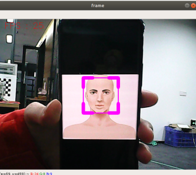

## 人脸识别

### 1、简介

MediaPipe是⼀款由Google开发并开源的数据流处理机器学习应⽤开发框架。它是⼀个基于图的数据处理管线，⽤于构建使⽤了多种形式的数据源，如视频、⾳频、传感器数据以及任何时间序列数据。MediaPipe是跨平台的，可以运⾏在嵌⼊式平台(树莓派等)，移动设备(iOS和Android)，⼯作站和服务器上，并⽀持移动端GPU加速。 MediaPipe为实时和流媒体提供跨平台、可定制的ML解决⽅案。MediaPipe 的核⼼框架由 C++ 实现，并提供 Java 以及 Objective C 等语⾔的⽀持。MediaPipe 的主要概念包括数据包（Packet）、数据流（Stream）、计算单元（Calculator）、图（Graph）以及⼦图（Subgraph）。

MediaPipe的特点：

- 端到端加速：内置的快速ML推理和处理即使在普通硬件上也能加速。
- ⼀次构建，随时随地部署：统⼀解决⽅案适⽤于Android、iOS、桌⾯/云、web和物联⽹。
- 即⽤解决⽅案：展⽰框架全部功能的尖端ML解决⽅案。
- 免费开源：Apache2.0下的框架和解决⽅案，完全可扩展和定制。

### 2、人脸识别

#### 2.1、启动

1. 先给ROS-wifi图传模块设置好代理的IP，具体的步骤，请看基本使用的**1.ROS-wifi图传模块在micros小车的使用**教程，本教程不再阐述

2. Linux 系统连接ROS-wifi图传模块，启动docket，输入以下指令进行ROS-wifi图传模块的连接
```shell
#使用提供的系统直接输入
sh start_Camera_computer.sh
```


```shell
#不是资料的系统:
docker run -it --rm -v /dev:/dev -v /dev/shm:/dev/shm --privileged --net=host microros/micro-ros-agent:humble udp4 --port 9999 -v4
```

出现以上信息，说明代理连接成功
3. 打开一个新的终端，执行以下命令
```
ros2 run nanocam_esp32_mediapipe 05_FaceEyeDetection
```



4. 如果摄像头的画面是倒置的，请看**基础使用的3.摄像头画面改变**教程，本教程不再阐述


#### 2.2、代码解析

该功能源码的位置位于，

```
~/nanocamcar_ws/src/nanocam_esp32_mediapipe/nanocam_esp32_mediapipe/05_FaceEyeDetection.py
```

```py
class FaceEyeDetection(Node):
    def __init__(self,name):
        super().__init__(name)
        self.bridge = CvBridge()
        self.eyeDetect = cv.CascadeClassifier( "/home/nanocam/nanocamcar_ws/src/nanocam_esp32_mediapipe/nanocam_esp32_mediapipe/file/haarcascade_eye.xml")
        self.faceDetect = cv.CascadeClassifier("/home/nanocam/nanocamcar_ws/src/nanocam_esp32_mediapipe/nanocam_esp32_mediapipe/file/haarcascade_eye.xml")
        self.pub_rgb = self.create_publisher(Image,"/FaceEyeDetection/image", 500)

    def cancel(self):
        self.pub_rgb.unregister()

    def face(self, frame):
        gray = cv.cvtColor(frame, cv.COLOR_BGR2GRAY)
        faces = self.faceDetect.detectMultiScale(gray, 1.3)
        for face in faces: frame = self.faceDraw(frame, face)
        return frame

    def eye(self, frame):
        gray = cv.cvtColor(frame, cv.COLOR_BGR2GRAY)
        eyes = self.eyeDetect.detectMultiScale(gray, 1.3)
        for eye in eyes:
            cv.circle(frame, (int(eye[0] + eye[2] / 2), int(eye[1] + eye[3] / 2)), (int(eye[3] / 2)), (0, 0, 255), 2)
        return frame

    def faceDraw(self, frame, bbox, l=30, t=10):
        x, y, w, h = bbox
        x1, y1 = x + w, y + h
        cv.rectangle(frame, (x, y), (x + w, y + h), (255, 0, 255), 2)
        # Top left x,y
        cv.line(frame, (x, y), (x + l, y), (255, 0, 255), t)
        cv.line(frame, (x, y), (x, y + l), (255, 0, 255), t)
        # Top right x1,y
        cv.line(frame, (x1, y), (x1 - l, y), (255, 0, 255), t)
        cv.line(frame, (x1, y), (x1, y + l), (255, 0, 255), t)
        # Bottom left x1,y1
        cv.line(frame, (x, y1), (x + l, y1), (255, 0, 255), t)
        cv.line(frame, (x, y1), (x, y1 - l), (255, 0, 255), t)
        # Bottom right x1,y1
        cv.line(frame, (x1, y1), (x1 - l, y1), (255, 0, 255), t)
        cv.line(frame, (x1, y1), (x1, y1 - l), (255, 0, 255), t)
        return frame

    def pub_img(self, frame):
        self.pub_rgb.publish(self.bridge.cv2_to_imgmsg(frame, "bgr8"))

class MY_Picture(Node):
    def __init__(self, name):
        super().__init__(name)
        self.bridge = CvBridge()
        self.sub_img = self.create_subscription(
            CompressedImage, '/espRos/esp32camera', self.handleTopic, 1) #获取esp32传来的图像

        self.face_eye_detection = FaceEyeDetection('face_eye_detection')
        self.content = ["face", "eye", "face_eye"]
        self.content_index = 0

    def handleTopic(self, msg):
        start = time.time()
        frame = self.bridge.compressed_imgmsg_to_cv2(msg)
        frame = cv.resize(frame, (640, 480))
        cv.waitKey(10)

        
        action = cv.waitKey(1) & 0xFF
        if action == ord("f") or action == ord("F"):
            self.content_index += 1
            if self.content_index >= len(self.content): self.content_index = 0
        if self.content[self.content_index] == "face": frame = self.face_eye_detection.face(frame)
        elif self.content[self.content_index] == "eye": frame = self.face_eye_detection.eye(frame)
        else: frame = self.face_eye_detection.eye(self.face_eye_detection.face(frame))
                
        end = time.time()
        fps = 1 / (end - start)
        text = "FPS : " + str(int(fps))
        cv.putText(frame, text, (20, 30), cv.FONT_HERSHEY_SIMPLEX, 0.9, (0, 0, 255), 1)

        cv.imshow('frame', frame)

        self.face_eye_detection.pub_img(frame)
        # print(frame)
    
        cv.waitKey(10)

def main():
    print("start it")
    rclpy.init()
    esp_img = MY_Picture("My_Picture")
    try:
            rclpy.spin(esp_img)
    except KeyboardInterrupt:
        pass
    finally:
        esp_img.destroy_node()
        rclpy.shutdown()
```
该程序的主要流程：订阅esp32传出来的图像后，通过MediaPipe去做相关的识别后，再通过opencv把处理的图像显示出来。


