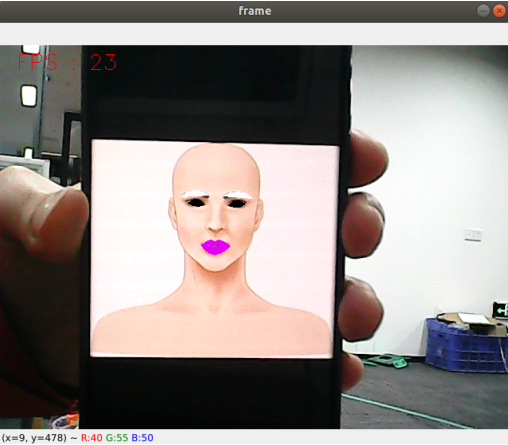

## 人脸特效

### 1、简介

MediaPipe是⼀款由Google开发并开源的数据流处理机器学习应⽤开发框架。它是⼀个基于图的数据处理管线，⽤于构建使⽤了多种形式的数据源，如视频、⾳频、传感器数据以及任何时间序列数据。MediaPipe是跨平台的，可以运⾏在嵌⼊式平台(树莓派等)，移动设备(iOS和Android)，⼯作站和服务器上，并⽀持移动端GPU加速。 MediaPipe为实时和流媒体提供跨平台、可定制的ML解决⽅案。MediaPipe 的核⼼框架由 C++ 实现，并提供 Java 以及 Objective C 等语⾔的⽀持。MediaPipe 的主要概念包括数据包（Packet）、数据流（Stream）、计算单元（Calculator）、图（Graph）以及⼦图（Subgraph）。

MediaPipe的特点：

- 端到端加速：内置的快速ML推理和处理即使在普通硬件上也能加速。
- ⼀次构建，随时随地部署：统⼀解决⽅案适⽤于Android、iOS、桌⾯/云、web和物联⽹。
- 即⽤解决⽅案：展⽰框架全部功能的尖端ML解决⽅案。
- 免费开源：Apache2.0下的框架和解决⽅案，完全可扩展和定制。

### 2、人脸特效

#### 2.1、启动

1. 先给ROS-wifi图传模块设置好代理的IP，具体的步骤，请看基本使用的**1.ROS-wifi图传模块在micros小车的使用**教程，本教程不再阐述

2. Linux 系统连接ROS-wifi图传模块，启动docket，输入以下指令进行ROS-wifi图传模块的连接
```shell
#使用提供的系统直接输入
sh start_Camera_computer.sh
```


```shell
#不是资料的系统:
docker run -it --rm -v /dev:/dev -v /dev/shm:/dev/shm --privileged --net=host microros/micro-ros-agent:humble udp4 --port 9999 -v4
```

出现以上信息，说明代理连接成功

3. 打开一个新的终端，执行以下命令
```
ros2 run nanocam_esp32_mediapipe 06_FaceLandmarks
```



4. 如果摄像头的画面是倒置的，请看**基础使用的3.摄像头画面改变**教程，本教程不再阐述


#### 2.2、代码解析

该功能源码的位置位于，

```
~/nanocamcar_ws/src/nanocam_esp32_mediapipe/nanocam_esp32_mediapipe/06_FaceLandmarks.py 
```

```py
class FaceLandmarks:
    def __init__(self, dat_file):
        self.hog_face_detector = dlib.get_frontal_face_detector()
        self.dlib_facelandmark = dlib.shape_predictor(dat_file)
        

    def get_face(self, frame, draw=True):
        gray = cv.cvtColor(frame, cv.COLOR_BGR2GRAY)
        self.faces = self.hog_face_detector(gray)
        for face in self.faces:
            self.face_landmarks = self.dlib_facelandmark(gray, face)
            if draw:
                for n in range(68):
                    x = self.face_landmarks.part(n).x
                    y = self.face_landmarks.part(n).y
                    cv.circle(frame, (x, y), 2, (0, 255, 255), 2)
                    cv.putText(frame, str(n), (x, y), cv.FONT_HERSHEY_SIMPLEX, 0.6, (0, 255, 255), 2)
        return frame

    def get_lmList(self, frame, p1, p2, draw=True):
        lmList = []
        if len(self.faces) != 0:
            for n in range(p1, p2):
                x = self.face_landmarks.part(n).x
                y = self.face_landmarks.part(n).y
                lmList.append([x, y])
                if draw:
                    next_point = n + 1
                    if n == p2 - 1: next_point = p1
                    x2 = self.face_landmarks.part(next_point).x
                    y2 = self.face_landmarks.part(next_point).y
                    cv.line(frame, (x, y), (x2, y2), (0, 255, 0), 1)
        return lmList

    def get_lipList(self, frame, lipIndexlist, draw=True):
        lmList = []
        if len(self.faces) != 0:
            for n in range(len(lipIndexlist)):
                x = self.face_landmarks.part(lipIndexlist[n]).x
                y = self.face_landmarks.part(lipIndexlist[n]).y
                lmList.append([x, y])
                if draw:
                    next_point = n + 1
                    if n == len(lipIndexlist) - 1: next_point = 0
                    x2 = self.face_landmarks.part(lipIndexlist[next_point]).x
                    y2 = self.face_landmarks.part(lipIndexlist[next_point]).y
                    cv.line(frame, (x, y), (x2, y2), (0, 255, 0), 1)
        return lmList

    def prettify_face(self, frame, eye=True, lips=True, eyebrow=True, draw=True):
        if eye:
            leftEye = landmarks.get_lmList(frame, 36, 42)
            rightEye = landmarks.get_lmList(frame, 42, 48)
            if draw:
                if len(leftEye) != 0: frame = cv.fillConvexPoly(frame, np.mat(leftEye), (0, 0, 0))
                if len(rightEye) != 0: frame = cv.fillConvexPoly(frame, np.mat(rightEye), (0, 0, 0))
        if lips:
            lipIndexlistA = [51, 52, 53, 54, 64, 63, 62]
            lipIndexlistB = [48, 49, 50, 51, 62, 61, 60]
            lipsUpA = landmarks.get_lipList(frame, lipIndexlistA, draw=True)
            lipsUpB = landmarks.get_lipList(frame, lipIndexlistB, draw=True)
            lipIndexlistA = [57, 58, 59, 48, 67, 66]
            lipIndexlistB = [54, 55, 56, 57, 66, 65, 64]
            lipsDownA = landmarks.get_lipList(frame, lipIndexlistA, draw=True)
            lipsDownB = landmarks.get_lipList(frame, lipIndexlistB, draw=True)
            if draw:
                if len(lipsUpA) != 0: frame = cv.fillConvexPoly(frame, np.mat(lipsUpA), (249, 0, 226))
                if len(lipsUpB) != 0: frame = cv.fillConvexPoly(frame, np.mat(lipsUpB), (249, 0, 226))
                if len(lipsDownA) != 0: frame = cv.fillConvexPoly(frame, np.mat(lipsDownA), (249, 0, 226))
                if len(lipsDownB) != 0: frame = cv.fillConvexPoly(frame, np.mat(lipsDownB), (249, 0, 226))
        if eyebrow:
            lefteyebrow = landmarks.get_lmList(frame, 17, 22)
            righteyebrow = landmarks.get_lmList(frame, 22, 27)
            if draw:
                if len(lefteyebrow) != 0: frame = cv.fillConvexPoly(frame, np.mat(lefteyebrow), (255, 255, 255))
                if len(righteyebrow) != 0: frame = cv.fillConvexPoly(frame, np.mat(righteyebrow), (255, 255, 255))
        return frame

class MY_Picture(Node):
    def __init__(self, name,landmarkss):
        super().__init__(name)
        self.bridge = CvBridge()
        self.sub_img = self.create_subscription(
            CompressedImage, '/espRos/esp32camera', self.handleTopic, 1) #获取esp32传来的图像
        self.landmarksros = landmarkss

    def handleTopic(self, msg):
        start = time.time()
        frame = self.bridge.compressed_imgmsg_to_cv2(msg)
        frame = cv.resize(frame, (640, 480))
        cv.waitKey(10)
        frame = self.landmarksros.get_face(frame, draw=False)
        frame = self.landmarksros.prettify_face(frame, eye=True, lips=True, eyebrow=True, draw=True)

        end = time.time()
        fps = 1 / (end - start)
        text = "FPS : " + str(int(fps))
        cv.putText(frame, text, (20, 30), cv.FONT_HERSHEY_SIMPLEX, 0.9, (0, 0, 255), 1)

        cv.imshow('frame', frame)


landmarks = None
def main():
    global landmarks
    print("start it")
    dat_file = "/home/nanocam/nanocamcar_ws/src/nanocam_esp32_mediapipe/nanocam_esp32_mediapipe/file/shape_predictor_68_face_landmarks.dat"
    landmarks = FaceLandmarks(dat_file)

    rclpy.init()
    esp_img = MY_Picture("My_Picture",landmarks)
    try:
            rclpy.spin(esp_img)
    except KeyboardInterrupt:
        pass
    finally:
        esp_img.destroy_node()
        rclpy.shutdown()
```
该程序的主要流程：订阅esp32传出来的图像后，通过MediaPipe去做相关的识别后，再通过opencv把处理的图像显示出来。


