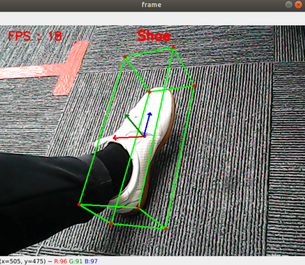
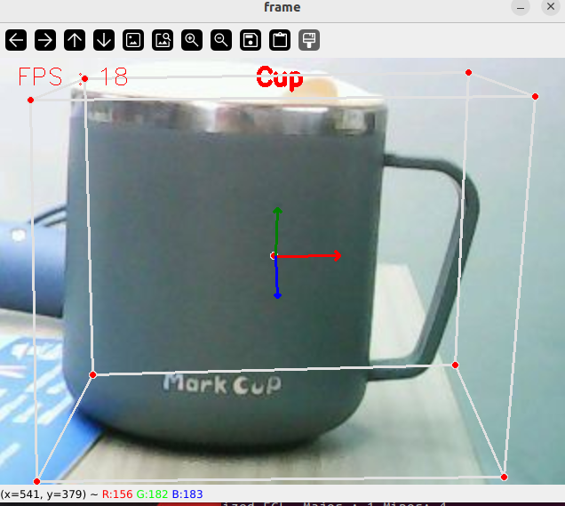

## 三维物体识别

### 1、简介

MediaPipe是⼀款由Google开发并开源的数据流处理机器学习应⽤开发框架。它是⼀个基于图的数据处理管线，⽤于构建使⽤了多种形式的数据源，如视频、⾳频、传感器数据以及任何时间序列数据。MediaPipe是跨平台的，可以运⾏在嵌⼊式平台(树莓派等)，移动设备(iOS和Android)，⼯作站和服务器上，并⽀持移动端GPU加速。 MediaPipe为实时和流媒体提供跨平台、可定制的ML解决⽅案。

MediaPipe 的核⼼框架由 C++ 实现，并提供 Java 以及 Objective C 等语⾔的⽀持。MediaPipe 的主要概念包括数据包（Packet）、数据流（Stream）、计算单元（Calculator）、图（Graph）以及⼦图（Subgraph）。

MediaPipe的特点：

- 端到端加速：内置的快速ML推理和处理即使在普通硬件上也能加速。
- ⼀次构建，随时随地部署：统⼀解决⽅案适⽤于Android、iOS、桌⾯/云、web和物联⽹。
- 即⽤解决⽅案：展⽰框架全部功能的尖端ML解决⽅案。
- 免费开源：Apache2.0下的框架和解决⽅案，完全可扩展和定制。

### 2、三维物体识别

三维物体识别：可识别的物体有：【'Shoe', 'Chair', 'Cup', 'Camera'】，⼀共4类；点击【f键】切换识别物体。

**注：f键切换物体，需要在树莓派联网的情况下才能正常切换，因为需要连网下载预训练模型。**

#### 2.1、启动

1. 先给ROS-wifi图传模块设置好代理的IP，具体的步骤，请看基本使用的**1.ROS-wifi图传模块在micros小车的使用**教程，本教程不再阐述

2. Linux 系统连接ROS-wifi图传模块，启动docket，输入以下指令进行ROS-wifi图传模块的连接
```shell
#使用提供的系统直接输入
sh start_Camera_computer.sh
```


```shell
#不是资料的系统:
docker run -it --rm -v /dev:/dev -v /dev/shm:/dev/shm --privileged --net=host microros/micro-ros-agent:humble udp4 --port 9999 -v4
```

出现以上信息，说明代理连接成功

3. 打开一个新的终端，执行以下命令
```
ros2 run nanocam_esp32_mediapipe 08_Objectron
```

鞋子


水杯



4. 如果摄像头的画面是倒置的，请看**基础使用的3.摄像头画面改变**教程，本教程不再阐述


#### 2.2、代码解析

该功能源码的位置位于，

```
~/nanocamcar_ws/src/nanocam_esp32_mediapipe/nanocam_esp32_mediapipe/08_Objectron.py 
```

```py
#!/usr/bin/env python3
class Objectron:
    def __init__(self, staticMode=False, maxObjects=5, minDetectionCon=0.5, minTrackingCon=0.99):
        self.staticMode=staticMode
        self.maxObjects=maxObjects
        self.minDetectionCon=minDetectionCon
        self.minTrackingCon=minTrackingCon
        self.index=3
        self.modelNames = ['Shoe', 'Chair', 'Cup', 'Camera']
        self.mpObjectron = mp.solutions.objectron
        self.mpDraw = mp.solutions.drawing_utils
        self.mpobjectron = self.mpObjectron.Objectron(
            self.staticMode, self.maxObjects, self.minDetectionCon, self.minTrackingCon, self.modelNames[self.index])

    def findObjectron(self, frame):
        cv.putText(frame, self.modelNames[self.index], (int(frame.shape[1] / 2) - 30, 30),
                   cv.FONT_HERSHEY_SIMPLEX, 0.9, (0, 0, 255), 3)
        img_RGB = cv.cvtColor(frame, cv.COLOR_BGR2RGB)
        results = self.mpobjectron.process(img_RGB)
        if results.detected_objects:
            for id, detection in enumerate(results.detected_objects):
                self.mpDraw.draw_landmarks(frame, detection.landmarks_2d, self.mpObjectron.BOX_CONNECTIONS)
                self.mpDraw.draw_axis(frame, detection.rotation, detection.translation)
        return frame

    def configUP(self):
        self.index += 1
        if self.index>=4:self.index=0
        self.mpobjectron = self.mpObjectron.Objectron(
            self.staticMode, self.maxObjects, self.minDetectionCon, self.minTrackingCon, self.modelNames[self.index])


class MY_Picture(Node):
    def __init__(self, name):
        super().__init__(name)
        self.bridge = CvBridge()
        self.sub_img = self.create_subscription(
            CompressedImage, '/espRos/esp32camera', self.handleTopic, 1) #获取esp32传来的图像

        self.objectron = Objectron()

    def handleTopic(self, msg):
        start = time.time()
        frame = self.bridge.compressed_imgmsg_to_cv2(msg)
        frame = cv.resize(frame, (640, 480))

        action = cv.waitKey(1) & 0xFF
        if action == ord('f') or action == ord('F') :  self.objectron.configUP()
        frame = self.objectron.findObjectron(frame)
        
        end = time.time()
        fps = 1 / (end - start)
        text = "FPS : " + str(int(fps))
        cv.putText(frame, text, (20, 30), cv.FONT_HERSHEY_SIMPLEX, 0.9, (0, 0, 255), 1)
        cv.imshow('frame', frame)


def main():
    print("start it")
    rclpy.init()
    esp_img = MY_Picture("My_Picture")
    try:
            rclpy.spin(esp_img)
    except KeyboardInterrupt:
        pass
    finally:
        esp_img.destroy_node()
        rclpy.shutdown()
```
该程序的主要流程：订阅esp32传出来的图像后，通过MediaPipe去做相关的识别后，再通过opencv把处理的图像显示出来。


