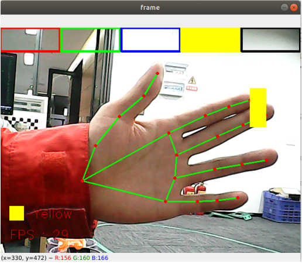

## 画笔

### 1、简介

MediaPipe是⼀款由Google开发并开源的数据流处理机器学习应⽤开发框架。它是⼀个基于图的数据处理管线，⽤于构建使⽤了多种形式的数据源，如视频、⾳频、传感器数据以及任何时间序列数据。MediaPipe是跨平台的，可以运⾏在嵌⼊式平台(树莓派等)，移动设备(iOS和Android)，⼯作站和服务器上，并⽀持移动端GPU加速。 MediaPipe为实时和流媒体提供跨平台、可定制的ML解决⽅案。

MediaPipe 的核⼼框架由 C++ 实现，并提供 Java 以及 Objective C 等语⾔的⽀持。MediaPipe 的主要概念包括数据包（Packet）、数据流（Stream）、计算单元（Calculator）、图（Graph）以及⼦图（Subgraph）。

MediaPipe的特点：

- 端到端加速：内置的快速ML推理和处理即使在普通硬件上也能加速。
- ⼀次构建，随时随地部署：统⼀解决⽅案适⽤于Android、iOS、桌⾯/云、web和物联⽹。
- 即⽤解决⽅案：展⽰框架全部功能的尖端ML解决⽅案。
- 免费开源：Apache2.0下的框架和解决⽅案，完全可扩展和定制。

### 2、画笔

右⼿⾷指和中指合并时是选择状态，同时弹出颜⾊选框，两指尖移动到对应颜⾊位置时，选中该颜⾊（⿊⾊为橡⽪擦）；⾷指和中指分开始是绘画状态，可在画板上任意绘制。

#### 2.1、启动

1. 先给ROS-wifi图传模块设置好代理的IP，具体的步骤，请看基本使用的**1.ROS-wifi图传模块在micros小车的使用**教程，本教程不再阐述

2. Linux 系统连接ROS-wifi图传模块，启动docket，输入以下指令进行ROS-wifi图传模块的连接
```shell
#使用提供的系统直接输入
sh start_Camera_computer.sh
```


```shell
#不是资料的系统:
docker run -it --rm -v /dev:/dev -v /dev/shm:/dev/shm --privileged --net=host microros/micro-ros-agent:humble udp4 --port 9999 -v4
```

出现以上信息，说明代理连接成功

3. 打开一个新的终端，执行以下命令
```
ros2 run nanocam_esp32_mediapipe 09_VirtualPaint
```



4. 如果摄像头的画面是倒置的，请看**基础使用的3.摄像头画面改变**教程，本教程不再阐述


#### 2.2、代码解析
```
~/nanocamcar_ws/src/nanocam_esp32_mediapipe/nanocam_esp32_mediapipe/09_VirtualPaint.py
```

```py
xp = yp = pTime = boxx = 0
tipIds = [4, 8, 12, 16, 20]
imgCanvas = np.zeros((480, 640, 3), np.uint8)
brushThickness = 5
eraserThickness = 100
top_height = 50
Color = "Red"
ColorList = {
    'Red': (0, 0, 255),
    'Green': (0, 255, 0),
    'Blue': (255, 0, 0),
    'Yellow': (0, 255, 255),
    'Black': (0, 0, 0),
}

class handDetector:
    def __init__(self, mode=False, maxHands=2, detectorCon=0.5, trackCon=0.5):
        self.tipIds = [4, 8, 12, 16, 20]
        self.mpHand = mp.solutions.hands
        self.mpDraw = mp.solutions.drawing_utils
        self.hands = self.mpHand.Hands(
            static_image_mode=mode,
            max_num_hands=maxHands,
            min_detection_confidence=detectorCon,
            min_tracking_confidence=trackCon )
        self.lmDrawSpec = mp.solutions.drawing_utils.DrawingSpec(color=(0, 0, 255), thickness=-1, circle_radius=15)
        self.drawSpec = mp.solutions.drawing_utils.DrawingSpec(color=(0, 255, 0), thickness=10, circle_radius=10)

    def findHands(self, frame, draw=True):
        self.lmList = []
        img_RGB = cv.cvtColor(frame, cv.COLOR_BGR2RGB)
        self.results = self.hands.process(img_RGB)
        if self.results.multi_hand_landmarks:
            for handLms in self.results.multi_hand_landmarks:
                if draw: self.mpDraw.draw_landmarks(frame, handLms, self.mpHand.HAND_CONNECTIONS, self.lmDrawSpec, self.drawSpec)
                else: self.mpDraw.draw_landmarks(frame, handLms, self.mpHand.HAND_CONNECTIONS)
            for id, lm in enumerate(self.results.multi_hand_landmarks[0].landmark):
                h, w, c = frame.shape
                cx, cy = int(lm.x * w), int(lm.y * h)
                # print(id, cx, cy)
                self.lmList.append([id, cx, cy])
        return frame, self.lmList

    def fingersUp(self):
        fingers=[]
        # Thumb
        if (self.calc_angle(self.tipIds[0],
                            self.tipIds[0] - 1,
                            self.tipIds[0] - 2) > 150.0) and (
                self.calc_angle(
                    self.tipIds[0] - 1,
                    self.tipIds[0] - 2,
                    self.tipIds[0] - 3) > 150.0): fingers.append(1)
        else:
            fingers.append(0)
        # 4 finger
        for id in range(1, 5):
            if self.lmList[self.tipIds[id]][2] < self.lmList[self.tipIds[id] - 2][2]:
                fingers.append(1)
            else:
                fingers.append(0)
        return fingers


    def get_dist(self, point1, point2):
        x1, y1 = point1
        x2, y2 = point2
        return abs(math.sqrt(math.pow(abs(y1 - y2), 2) + math.pow(abs(x1 - x2), 2)))

    def calc_angle(self, pt1, pt2, pt3):
        point1 = self.lmList[pt1][1], self.lmList[pt1][2]
        point2 = self.lmList[pt2][1], self.lmList[pt2][2]
        point3 = self.lmList[pt3][1], self.lmList[pt3][2]
        a = self.get_dist(point1, point2)
        b = self.get_dist(point2, point3)
        c = self.get_dist(point1, point3)
        try:
            radian = math.acos((math.pow(a, 2) + math.pow(b, 2) - math.pow(c, 2)) / (2 * a * b))
            angle = radian / math.pi * 180
        except:
            angle = 0
        return abs(angle)


class MY_Picture(Node):
    def __init__(self, name,ColorROS,ColorListROS):
        super().__init__(name)
        self.bridge = CvBridge()
        self.sub_img = self.create_subscription(
            CompressedImage, '/espRos/esp32camera', self.handleTopic, 1) #获取esp32传来的图像
            
        self.hand_detector = handDetector(detectorCon=0.85)
        self.Color = ColorROS
        self.ColorList = ColorListROS
        self.boxx = 0
        self.xp = 0
        self.yp = 0
        self.top_height = 50
        
    def handleTopic(self, msg):
        start = time.time()
        frame = self.bridge.compressed_imgmsg_to_cv2(msg)
        frame = cv.resize(frame, (640, 480))
        h, w, c = frame.shape
        cv.waitKey(10)

        frame,lmList  = self.hand_detector.findHands(frame, draw=False)
        if len(lmList) != 0:
            # print(lmList)
            # tip of index and middle fingers
            x1, y1 = lmList[8][1:]
            x2, y2 = lmList[12][1:]
            
            fingers = self.hand_detector.fingersUp()
            if fingers[1] and fingers[2]:
                # print("Seclection mode")
                if y1 < self.top_height:
                    if 0 < x1 < int(w / 5) - 1:
                        self.boxx = 0
                        self.Color = "Red"
                    if int(w / 5) < x1 < int(w * 2 / 5) - 1:
                        self.boxx = int(w / 5)
                        self.Color = "Green"
                    elif int(w * 2 / 5) < x1 < int(w * 3 / 5) - 1:
                        self.boxx = int(w * 2 / 5)
                        self.Color = "Blue"
                    elif int(w * 3 / 5) < x1 < int(w * 4 / 5) - 1:
                        self.boxx = int(w * 3 / 5)
                        self.Color = "Yellow"
                    elif int(w * 4 / 5) < x1 < w - 1:
                        self.boxx = int(w * 4 / 5)
                        self.Color = "Black"
                cv.rectangle(frame, (x1, y1 - 25), (x2, y2 + 25), self.ColorList[self.Color], cv.FILLED)
                cv.rectangle(frame, (self.boxx, 0), (self.boxx + int(w / 5), self.top_height), self.ColorList[self.Color], cv.FILLED)
                cv.rectangle(frame, (0, 0), (int(w / 5) - 1, self.top_height), self.ColorList['Red'], 3)
                cv.rectangle(frame, (int(w / 5) + 2, 0), (int(w * 2 / 5) - 1, self.top_height), self.ColorList['Green'], 3)
                cv.rectangle(frame, (int(w * 2 / 5) + 2, 0), (int(w * 3 / 5) - 1, self.top_height), self.ColorList['Blue'], 3)
                cv.rectangle(frame, (int(w * 3 / 5) + 2, 0), (int(w * 4 / 5) - 1, self.top_height), self.ColorList['Yellow'], 3)
                cv.rectangle(frame, (int(w * 4 / 5) + 2, 0), (w - 1, self.top_height), self.ColorList['Black'], 3)
            if fingers[1] and fingers[2] == False and math.hypot(x2 - x1, y2 - y1) > 50:
                # print("Drawing mode")
                if self.xp == self.yp == 0: self.xp, self.yp = x1, y1
                if self.Color == 'Black':
                    cv.line(frame, (self.xp, self.yp), (x1, y1), self.ColorList[self.Color], eraserThickness)
                    cv.line(imgCanvas, (self.xp, self.yp), (x1, y1), self.ColorList[self.Color], eraserThickness)
                else:
                    cv.line(frame, (self.xp, self.yp), (x1, y1), self.ColorList[self.Color], brushThickness)
                    cv.line(imgCanvas, (self.xp, self.yp), (x1, y1),self.ColorList[self.Color], brushThickness)
                cv.circle(frame, (x1, y1), 15, self.ColorList[self.Color], cv.FILLED)
                self.xp, self.yp = x1, y1
            else: self.xp = self.yp = 0
        imgGray = cv.cvtColor(imgCanvas, cv.COLOR_BGR2GRAY)
        _, imgInv = cv.threshold(imgGray, 50, 255, cv.THRESH_BINARY_INV)
        imgInv = cv.cvtColor(imgInv, cv.COLOR_GRAY2BGR)
        frame = cv.bitwise_and(frame, imgInv)
        frame = cv.bitwise_or(frame, imgCanvas)
        end = time.time()
        fps = 1 / (end - start)
        text = "FPS : " + str(int(fps))
        cv.putText(frame, text, (20, 30), cv.FONT_HERSHEY_SIMPLEX, 0.9, (0, 0, 255), 1)
        cv.rectangle(frame, (20, h - 100), (50, h - 70), self.ColorList[self.Color], cv.FILLED)
        cv.putText(frame, self.Color, (70, h - 75), cv.FONT_HERSHEY_SIMPLEX, 0.9, (0, 0, 255), 1)
        cv.imshow('frame', frame)


def main():
    global Color,ColorList
    print("start it")
    rclpy.init()
    esp_img = MY_Picture("My_Picture",Color,ColorList)
    try:
        rclpy.spin(esp_img)
    except KeyboardInterrupt:
        pass
    finally:
        esp_img.destroy_node()
        rclpy.shutdown()
```
该程序的主要流程：订阅esp32传出来的图像后，通过MediaPipe去做相关的识别后，再通过opencv把处理的图像显示出来。


