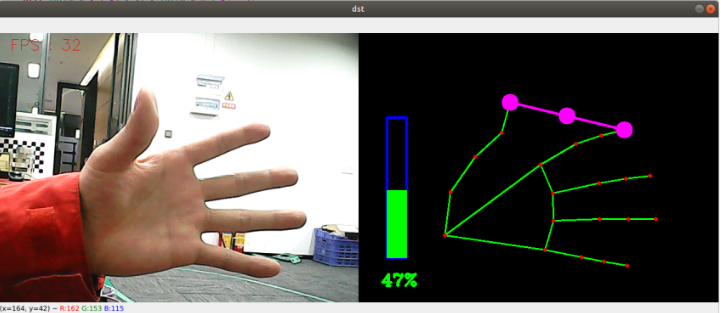

## 手指控制

### 1、简介

MediaPipe是⼀款由Google开发并开源的数据流处理机器学习应⽤开发框架。它是⼀个基于图的数据处理管线，⽤于构建使⽤了多种形式的数据源，如视频、⾳频、传感器数据以及任何时间序列数据。

MediaPipe是跨平台的，可以运⾏在嵌⼊式平台(树莓派等)，移动设备(iOS和Android)，⼯作站和服务器上，并⽀持移动端GPU加速。 MediaPipe为实时和流媒体提供跨平台、可定制的ML解决⽅案。

MediaPipe 的核⼼框架由 C++ 实现，并提供 Java 以及 Objective C 等语⾔的⽀持。MediaPipe 的主要概念包括数据包（Packet）、数据流（Stream）、计算单元（Calculator）、图（Graph）以及⼦图（Subgraph）。

MediaPipe的特点：

- 端到端加速：内置的快速ML推理和处理即使在普通硬件上也能加速。
- ⼀次构建，随时随地部署：统⼀解决⽅案适⽤于Android、iOS、桌⾯/云、web和物联⽹。
- 即⽤解决⽅案：展⽰框架全部功能的尖端ML解决⽅案。
- 免费开源：Apache2.0下的框架和解决⽅案，完全可扩展和定制

### 2、手指控制

点击【f键】切换识别效果，通过拇指与食指的距离（张/合），可以控制图像的效果。

#### 3.1、启动

1. 先给ROS-wifi图传模块设置好代理的IP，具体的步骤，请看基本使用的**1.ROS-wifi图传模块在micros小车的使用**教程，本教程不再阐述

2. Linux 系统连接ROS-wifi图传模块，启动docket，输入以下指令进行ROS-wifi图传模块的连接
```shell
#使用提供的系统直接输入
sh start_Camera_computer.sh
```


```shell
#不是资料的系统:
docker run -it --rm -v /dev:/dev -v /dev/shm:/dev/shm --privileged --net=host microros/micro-ros-agent:humble udp4 --port 9999 -v4
```

出现以上信息，说明代理连接成功

3. 打开一个新的终端，执行以下命令
```
ros2 run nanocam_esp32_mediapipe 10_HandCtrl
```



4. 如果摄像头的画面是倒置的，请看**基础使用的3.摄像头画面改变**教程，本教程不再阐述


#### 3.2、代码解析

该功能源码的位置位于，

```
~/nanocamcar_ws/src/nanocam_esp32_mediapipe/nanocam_esp32_mediapipe/10_HandCtrl.py
```

```py
volPer = value = index = 0
effect = ["color", "thresh", "blur", "hue", "enhance"]
volBar = 400
class handDetector:
    def __init__(self, mode=False, maxHands=2, detectorCon=0.5, trackCon=0.5):
        self.tipIds = [4, 8, 12, 16, 20]
        self.mpHand = mp.solutions.hands
        self.mpDraw = mp.solutions.drawing_utils
        self.hands = self.mpHand.Hands(
            static_image_mode=mode,
            max_num_hands=maxHands,
            min_detection_confidence=detectorCon,
            min_tracking_confidence=trackCon
        )
        self.lmDrawSpec = mp.solutions.drawing_utils.DrawingSpec(color=(0, 0, 255), thickness=-1, circle_radius=15)
        self.drawSpec = mp.solutions.drawing_utils.DrawingSpec(color=(0, 255, 0), thickness=10, circle_radius=10)

    def get_dist(self, point1, point2):
        x1, y1 = point1
        x2, y2 = point2
        return abs(math.sqrt(math.pow(abs(y1 - y2), 2) + math.pow(abs(x1 - x2), 2)))

    def calc_angle(self, pt1, pt2, pt3):
        point1 = self.lmList[pt1][1], self.lmList[pt1][2]
        point2 = self.lmList[pt2][1], self.lmList[pt2][2]
        point3 = self.lmList[pt3][1], self.lmList[pt3][2]
        a = self.get_dist(point1, point2)
        b = self.get_dist(point2, point3)
        c = self.get_dist(point1, point3)
        try:
            radian = math.acos((math.pow(a, 2) + math.pow(b, 2) - math.pow(c, 2)) / (2 * a * b))
            angle = radian / math.pi * 180
        except:
            angle = 0
        return abs(angle)

    def findHands(self, frame, draw=True):
        img = np.zeros(frame.shape, np.uint8)
        img_RGB = cv.cvtColor(frame, cv.COLOR_BGR2RGB)
        self.results = self.hands.process(img_RGB)
        if self.results.multi_hand_landmarks:
            for handLms in self.results.multi_hand_landmarks:
                if draw: self.mpDraw.draw_landmarks(img, handLms, self.mpHand.HAND_CONNECTIONS)
        return img

    def findPosition(self, frame, draw=True):
        self.lmList = []
        if self.results.multi_hand_landmarks:
            for id, lm in enumerate(self.results.multi_hand_landmarks[0].landmark):
                # print(id,lm)
                h, w, c = frame.shape
                cx, cy = int(lm.x * w), int(lm.y * h)
                # print(id, lm.x, lm.y, lm.z)
                self.lmList.append([id, cx, cy])
                if draw: cv.circle(frame, (cx, cy), 15, (0, 0, 255), cv.FILLED)
        return self.lmList

    def frame_combine(slef,frame, src):
        if len(frame.shape) == 3:
            frameH, frameW = frame.shape[:2]
            srcH, srcW = src.shape[:2]
            dst = np.zeros((max(frameH, srcH), frameW + srcW, 3), np.uint8)
            dst[:, :frameW] = frame[:, :]
            dst[:, frameW:] = src[:, :]
        else:
            src = cv.cvtColor(src, cv.COLOR_BGR2GRAY)
            frameH, frameW = frame.shape[:2]
            imgH, imgW = src.shape[:2]
            dst = np.zeros((frameH, frameW + imgW), np.uint8)
            dst[:, :frameW] = frame[:, :]
            dst[:, frameW:] = src[:, :]
        return dst

class MY_Picture(Node):
    def __init__(self, name):
        super().__init__(name)
        self.bridge = CvBridge()
        self.sub_img = self.create_subscription(
            CompressedImage, '/espRos/esp32camera', self.handleTopic, 1) #获取esp32传来的图像

        self.hand_detector = handDetector()
        self.volPer = self.value = self.index = 0
        self.effect = ["color", "thresh", "blur", "hue", "enhance"]
        self.volBar = 400

    def handleTopic(self, msg):
        start = time.time()
        frame = self.bridge.compressed_imgmsg_to_cv2(msg)
        frame = cv.resize(frame, (640, 480))

        action = cv.waitKey(1) & 0xFF

        img  = self.hand_detector.findHands(frame)
        lmList = self.hand_detector.findPosition(frame, draw=False)
        if len(lmList) != 0:
            angle = self.hand_detector.calc_angle(4, 0, 8)
            x1, y1 = lmList[4][1], lmList[4][2]
            x2, y2 = lmList[8][1], lmList[8][2]
            cx, cy = (x1 + x2) // 2, (y1 + y2) // 2
            cv.circle(img, (x1, y1), 15, (255, 0, 255), cv.FILLED)
            cv.circle(img, (x2, y2), 15, (255, 0, 255), cv.FILLED)
            cv.line(img, (x1, y1), (x2, y2), (255, 0, 255), 3)
            cv.circle(img, (cx, cy), 15, (255, 0, 255), cv.FILLED)
            if angle <= 10: cv.circle(img, (cx, cy), 15, (0, 255, 0), cv.FILLED)
            self.volBar = np.interp(angle, [0, 70], [400, 150])
            self.volPer = np.interp(angle, [0, 70], [0, 100])
            self.value = np.interp(angle, [0, 70], [0, 255])
            # print("angle: {},self.value: {}".format(angle, self.value))
        # 进行阈值二值化操作，大于阈值value的，使用255表示，小于阈值value的，使用0表示
        if self.effect[self.index]=="thresh":
            gray = cv.cvtColor(frame, cv.COLOR_BGR2GRAY)
            frame = cv.threshold(gray, self.value, 255, cv.THRESH_BINARY)[1]
        # 进行高斯滤波,(21, 21)表示高斯矩阵的长与宽都是21，标准差取value
        elif self.effect[self.index]=="blur":
            frame = cv.GaussianBlur(frame, (21, 21), np.interp(self.value, [0, 255], [0, 11]))
        # 色彩空间的转化,HSV转换为BGR
        elif self.effect[self.index]=="hue":
            frame = cv.cvtColor(frame, cv.COLOR_BGR2HSV)
            frame[:, :, 0] += int(self.value)
            frame = cv.cvtColor(frame, cv.COLOR_HSV2BGR)
        # 调节对比度
        elif self.effect[self.index]=="enhance":
            enh_val = self.value / 40
            clahe = cv.createCLAHE(clipLimit=enh_val, tileGridSize=(8, 8))
            lab = cv.cvtColor(frame, cv.COLOR_BGR2LAB)
            lab[:, :, 0] = clahe.apply(lab[:, :, 0])
            frame = cv.cvtColor(lab, cv.COLOR_LAB2BGR)
        if action == ord('f'):
            self.index += 1
            if self.index >= len(self.effect): self.index = 0
        
        end = time.time()
        fps = 1 / (end - start)
        text = "FPS : " + str(int(fps))
        cv.putText(frame, text, (20, 30), cv.FONT_HERSHEY_SIMPLEX, 0.9, (0, 0, 255), 1)
        cv.rectangle(img, (50, 150), (85, 400), (255, 0, 0), 3)
        cv.rectangle(img, (50, int(self.volBar)), (85, 400), (0, 255, 0), cv.FILLED)
        cv.putText(img, f'{int(self.volPer)}%', (40, 450), cv.FONT_HERSHEY_COMPLEX, 1, (0, 255, 0), 3)
        dst = self.hand_detector.frame_combine(frame, img)
        cv.imshow('dst', dst)


def main():
    print("start it")
    rclpy.init()
    esp_img = MY_Picture("My_Picture")
    try:
        rclpy.spin(esp_img)
    except KeyboardInterrupt:
        pass
    finally:
        esp_img.destroy_node()
        rclpy.shutdown()
```
该程序的主要流程：订阅esp32传出来的图像后，通过MediaPipe去做相关的识别后，再通过opencv把处理的图像显示出来。


